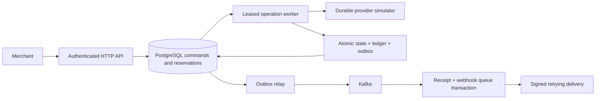

# PayFlow

Java 21 / Spring Boot payment-processing laboratory with PostgreSQL transactions, Kafka lifecycle events, Redis admission control, and a **durable simulated payment provider**. No real money or card data is processed.

## What is implemented

- Idempotent capture and partial-refund APIs. A unique merchant/scope/key record stores the request hash and original response in the same transaction as the command.
- Refund reservations under PostgreSQL row locks; concurrent requests cannot reserve more than the unrefunded amount.
- A durable provider simulator, stable operation keys, expiring worker leases, fencing tokens, and reconciliation of ambiguous outcomes.
- Immutable journals and entries, deferred balance checks, and rejection of entries appended after the original posting transaction.
- Transactional outbox with lease-based retries; Kafka consumer receipts and webhook queue writes share one transaction.
- HMAC-signed inbound/outbound webhooks, duplicate callback suppression, exponential delivery retries, and terminal-state protection.
- Merchant/operator RBAC, resource ownership checks, and an atomic Redis fixed-window limiter (fails closed if Redis is unavailable).
- PostgreSQL integration tests and a full Docker Compose smoke test in GitHub Actions.

## Run

Requires Docker Engine with Compose, or Docker Desktop with Linux containers. Run this project separately from SignalForge on an 8GB laptop.

```sh
docker compose up -d --build
docker compose logs -f app
python scripts/smoke.py
docker compose down
```

The API binds to `127.0.0.1:8080`. PostgreSQL binds to `127.0.0.1:5432`. Named volumes retain the database and Kafka log across restarts; `down` does not erase them. First startup may take a minute while Kafka initializes.

Development credentials: merchant `merchant-demo` / `local-merchant-password`, operator `operator` / `local-operator-password`. Set `MERCHANT_PASSWORD`, `OPERATOR_PASSWORD`, `DB_PASSWORD`, and `WEBHOOK_SECRET` in a local `.env` before any shared deployment. TLS, managed identities, secret management, hardened database roles, and production payment-provider integration are outside this local demonstration.

```sh
curl -u merchant-demo:local-merchant-password -H 'Content-Type: application/json' \
  -H 'Idempotency-Key: order-001' -d '{"amount":25000,"currency":"INR"}' \
  http://localhost:8080/v1/payments
curl -u merchant-demo:local-merchant-password http://localhost:8080/v1/payments/PAYMENT_UUID
curl -u merchant-demo:local-merchant-password -H 'Content-Type: application/json' \
  -H 'Idempotency-Key: refund-001' -d '{"amount":10000}' \
  http://localhost:8080/v1/payments/PAYMENT_UUID/refunds
curl -u operator:local-operator-password http://localhost:8080/ops/status
```

Amounts are integer minor units; 25000 INR minor units means INR 250.00. A `202` acknowledges a durable command, not completed capture. Poll the payment/refund resource until terminal. Retrying the same key/body returns the original response; a changed body produces `409`. Database/Redis outages may produce `503`; retry the same key.

## Architecture and failure semantics



Provider success can commit before the caller loses its response. A retry uses the same operation ID and retrieves the durable result. Lease expiry permits recovery after a worker dies; an old token cannot finalize. Kafka publication and merchant notifications are at-least-once. Consumers/receivers must deduplicate event IDs. HTTP callbacks are hints that wake authoritative reconciliation; a delayed failure callback cannot reverse a captured payment.

The simulator currently succeeds every accepted operation, except an operator-controlled lost-response fault. It is a durable state machine, **not a real payment network**. It shares PostgreSQL with the app but commits provider results in an independent transaction. The two role accounts and one configured outbound webhook endpoint intentionally keep the demo bounded. Delivery pauses after 20 attempts and requires operator investigation; there is no automatic forever-retry or payment rollback.

See [SRS and build guide](docs/SRS.md) for the larger design and [implementation/evidence map](docs/CLAIMS.md) for the implemented scope. The SRS includes future extensions; it is not an assertion that every proposed extension exists.

## Tests

```sh
mvn test                  # pure domain tests, no Docker
mvn -Pintegration verify  # real PostgreSQL Testcontainers; Docker required
python scripts/smoke.py    # against a running Compose stack
```

CI runs all three. Recovery tests cover retries, payload conflicts, provider response loss, stale-worker fencing, concurrent refunds, invalid/immutable ledger writes, duplicate lifecycle events, reordered signed callbacks, and merchant isolation. The smoke test exercises Redis, HTTP security, Kafka, outbox drain, and successful signed webhook delivery together.

## Benchmarks: targets, not claimed results

**1,200 RPS, p99 <35ms, and recovery <3s are unverified targets.** This repository does not assert they were measured. Do not equate HTTP acceptance with payment completion or process restart with full backlog recovery.

With k6 installed:

```sh
k6 run -e RATE=100 -e DURATION=60s -e RUN_ID=baseline benchmarks/load.js
k6 run -e RATE=1200 -e DURATION=60s -e RUN_ID=target benchmarks/load.js
```

`summary.json` includes all HTTP responses and dropped iterations. Preserve it under a unique run directory together with the git SHA, CPU/RAM/disk, Docker limits, workload duration, `/ops/status` snapshots, and `docker stats`. The 35ms threshold deliberately fails if unmet. HTTP Basic password verification is part of this workload. Measure queue depth during the run and time to drain after it; the serial provider worker and database round trips are likely bottlenecks long before a headline RPS target. Do not weaken durability or disable authentication just to improve a number.

Use `python benchmarks/recovery.py` for a scoped application-process failure trial. It records observed recovery, rather than forcing a passing result.

## Improving efficiency

1. Measure API authentication, pool wait, SQL time, and provider/ledger completion separately.
2. Profile operation polling and transaction round trips; introduce bounded worker concurrency while retaining locks, tokens, and stable provider IDs.
3. Batch outbox publication without marking events published before Kafka acknowledges.
4. Tune pools against measured database capacity; extra threads cannot create disk throughput.
5. Consider CDC and horizontally partitioned workers only after the correctness tests pass on the changed implementation.
