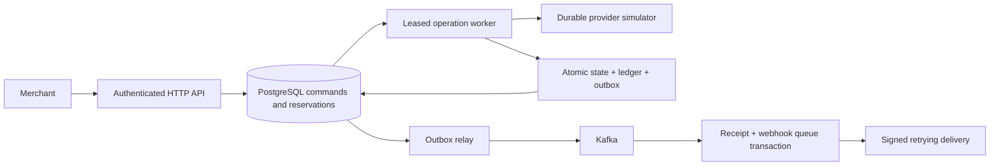

# PayFlow

Java 21 / Spring Boot payment-processing laboratory with PostgreSQL transactions, Kafka lifecycle events, Redis admission control, and a **durable simulated payment provider**. No real money or card data is processed.

## What is implemented

- Idempotent capture and partial-refund APIs. A unique merchant/scope/key record stores the request hash and original response in the same transaction as the command.
- Refund reservations under PostgreSQL row locks; concurrent requests cannot reserve more than the unrefunded amount.
- A durable provider simulator, stable operation keys, expiring worker leases, fencing tokens, and reconciliation of ambiguous outcomes.
- Immutable journals and entries, deferred balance checks, and rejection of entries appended after the original posting transaction.
- Transactional outbox with lease-based retries; Kafka consumer receipts and webhook queue writes share one transaction.
- HMAC-signed inbound/outbound webhooks, duplicate callback suppression, exponential delivery retries, and terminal-state protection.
- Merchant/operator RBAC, resource ownership checks, and an atomic Redis fixed-window limiter (fails closed if Redis is unavailable).
- PostgreSQL integration tests and a full Docker Compose smoke test in GitHub Actions.

## Run

Requires Docker Engine with Compose, or Docker Desktop with Linux containers. Run this project separately from SignalForge on an 8GB laptop.

```sh
docker compose up -d --build
docker compose logs -f app
python scripts/smoke.py
docker compose down
```

The API binds to `127.0.0.1:8080`. PostgreSQL binds to `127.0.0.1:5432`. Named volumes retain the database and Kafka log across restarts; `down` does not erase them. First startup may take a minute while Kafka initializes.

Development credentials: merchant `merchant-demo` / `local-merchant-password`, operator `operator` / `local-operator-password`. Set `MERCHANT_PASSWORD`, `OPERATOR_PASSWORD`, `DB_PASSWORD`, `JWT_SECRET` (at least 32 bytes), and `WEBHOOK_SECRET` in a local `.env` before any shared deployment. TLS, managed identities, secret management, hardened database roles, and production payment-provider integration are outside this local demonstration.

For repeated requests, exchange HTTP Basic credentials at `POST /auth/token` for a 15-minute signed JWT, then send `Authorization: Bearer TOKEN`. Signature, issuer, expiry, roles, and resource ownership are checked. A bearer token cannot mint a replacement token. Basic authentication remains available for manual examples below. The benchmark uses token authentication; password-hash verification happens once in setup.

```sh
curl -u merchant-demo:local-merchant-password -H 'Content-Type: application/json' \
  -H 'Idempotency-Key: order-001' -d '{"amount":25000,"currency":"INR"}' \
  http://localhost:8080/v1/payments
curl -u merchant-demo:local-merchant-password http://localhost:8080/v1/payments/PAYMENT_UUID
curl -u merchant-demo:local-merchant-password -H 'Content-Type: application/json' \
  -H 'Idempotency-Key: refund-001' -d '{"amount":10000}' \
  http://localhost:8080/v1/payments/PAYMENT_UUID/refunds
curl -u operator:local-operator-password http://localhost:8080/ops/status
```

Amounts are integer minor units; 25000 INR minor units means INR 250.00. A `202` acknowledges a durable command, not completed capture. Poll the payment/refund resource until terminal. Retrying the same key/body returns the original response; a changed body produces `409`. Database/Redis outages may produce `503`; retry the same key.

## Architecture and failure semantics



Provider success can commit before the caller loses its response. A retry uses the same operation ID and retrieves the durable result. Lease expiry permits recovery after a worker dies; an old token cannot finalize. Kafka publication and merchant notifications are at-least-once. Consumers/receivers must deduplicate event IDs. HTTP callbacks are hints that wake authoritative reconciliation; a delayed failure callback cannot reverse a captured payment.

The simulator currently succeeds every accepted operation, except an operator-controlled lost-response fault. It is a durable state machine, **not a real payment network**. It shares PostgreSQL with the app but commits provider results in an independent transaction. The two role accounts and one configured outbound webhook endpoint intentionally keep the demo bounded. Delivery pauses after 20 attempts and requires operator investigation; there is no automatic forever-retry or payment rollback.

See [SRS and build guide](docs/SRS.md) for the larger design and [implementation/evidence map](docs/CLAIMS.md) for the implemented scope. The SRS includes future extensions; it is not an assertion that every proposed extension exists.

The [OpenAPI contract](docs/openapi.yml) documents request/response and authentication boundaries. [Executed validation](docs/VALIDATION.md) links passing CI runs and preserves both failed and improved performance experiments.

## Tests

```sh
mvn test                  # pure domain tests, no Docker
mvn -Pintegration verify  # real PostgreSQL Testcontainers; Docker required
python scripts/smoke.py    # against a running Compose stack
```

CI runs all three. Recovery tests cover retries, payload conflicts, provider response loss, stale-worker fencing, concurrent refunds, invalid/immutable ledger writes, duplicate lifecycle events, reordered signed callbacks, and merchant isolation. The smoke test exercises Redis, HTTP security, Kafka, outbox drain, and successful signed webhook delivery together.

## Benchmarks: targets, not claimed results

**The combined 1,200-RPS / p99 <35ms / recovery <3s target has not been achieved.** A short 100-RPS JWT-authenticated CI run measured 28.43ms payment-acceptance p99 with no dropped iterations. The 1,200-RPS trials and restart-recovery target failed; see [all measured results](docs/VALIDATION.md). Do not equate HTTP acceptance with payment completion or process restart with full backlog recovery.

With k6 installed:

```sh
k6 run -e RATE=100 -e DURATION=60s -e RUN_ID=baseline benchmarks/load.js
k6 run -e RATE=1200 -e DURATION=60s -e RUN_ID=target benchmarks/load.js
```

`summary.json` includes all HTTP responses, p99, and dropped iterations. Preserve it under a unique run directory together with the git SHA, CPU/RAM/disk, Docker limits, workload duration, `/ops/status` snapshots, and `docker stats`. The 35ms threshold deliberately fails if unmet. Payment latency includes bearer-token verification. The profiling workflows mint a token before the load interval. Measure queue depth and completion alongside acceptance; fast `202` responses alone do not prove the workers keep up.

Use `python benchmarks/recovery.py` for a scoped application-process failure trial. It records observed recovery, rather than forcing a passing result.

## Improving efficiency

1. Optional `compose.profile.yml` enables Hikari acquisition timing, SQL execution/commit timers, PostgreSQL statement statistics, and restricted operator-only JFR capture. Profiling has overhead; it is disabled in the normal Compose stack.
2. Provider and webhook workers each default to four tasks. Capacity is reserved before database leasing, preserving fencing and stable provider IDs without an unbounded task queue. Configure `WORKER_CONCURRENCY` and `WEBHOOK_CONCURRENCY` in 1..16.
3. The outbox sends a bounded batch (default 128, maximum 512), waits for acknowledgements, then batches fenced PostgreSQL updates. Kafka failure leaves rows retryable; duplicate events remain possible and consumers deduplicate. Configure `OUTBOX_BATCH_SIZE`.
4. Tune pools against measured database capacity; extra threads cannot create disk throughput. The default `DB_POOL_SIZE=10` was retained after a 24-connection trial made the target-rate results worse.
5. Consider CDC and horizontally partitioned workers only after the correctness tests pass on the changed implementation.

## Reproduce the measurements

The Actions workflows `profile.yml`, `separate-hosts.yml`, and `startup.yml` run three trials and commit raw evidence, hardware, commit SHA, and README tables under [benchmarks/runs](benchmarks/runs). Failed thresholds stay visible. The separate-host workflow uses two runners and an authenticated temporary TLS relay with encrypted credential handoff. Relay latency and its 200-in-flight limit are part of that experiment; it is not a direct-LAN capacity test.

At 300 offered RPS for 15 seconds, [bounded-worker local trials](benchmarks/runs/42457755091/README.md) recorded acceptance p99 of 91.47, 16.42, and 14.31 ms with no dropped iterations. The two warmed trials had zero pending operations, events, and webhooks at the end snapshot. [The previous serial-worker trials](benchmarks/runs/42456894463/README.md) accumulated queues in all three trials. The first optimized trial still accumulated work and missed 35 ms. `drain.json` polling starts after diagnostic collection, so its duration is not latency from the final load request to completion.

[Separate-host optimized trials](benchmarks/runs/42457757552/README.md) recorded client p99 of 1153.11, 133.41, and 128.90 ms, with 27, 0, and 0 dropped iterations. All missed 35 ms. Do not subtract guessed network latency or present these as local Docker measurements.

## Startup experiments

Normal startup remains eager. Use `LAZY_INIT=true docker compose up -d --build` to opt into lazy initialization. For the trained Java 21 CDS image:

```sh
docker compose -f compose.yml -f compose.cds.yml up -d --build
python scripts/smoke.py
```

`Dockerfile.cds` extracts the application and trains an archive with dependency connections disabled only during training. Runtime enables normal migrations, workers and listeners, and requires the archive to load (`-Xshare:on`). Rebuild the archive with every application/JDK/image change. This follows the [Spring Boot CDS packaging guidance](https://docs.spring.io/spring-boot/3.5/reference/packaging/container-images/dockerfiles.html#packaging.container-images.dockerfiles.cds).

[Three startup trials per variant](benchmarks/runs/42457862855/README.md) measured:

| Variant | Health ready, seconds | First completed payment, seconds |
|---|---|---|
| Standard image | 5.78 / 5.62 / 5.66 | 6.08 / 5.90 / 5.85 |
| Lazy initialization | 5.86 / 5.67 / 5.72 | 6.08 / 5.95 / 5.99 |
| Extracted CDS image | 4.12 / 4.33 / 4.22 | 4.40 / 4.60 / 4.50 |

These are application restarts with warm dependencies, including Docker start-command time. Lazy initialization did not help in this run. CDS improved startup, but did not achieve three seconds; this comparison includes both the extracted layout and CDS. Variants used separate hosted runners, so host variation is a confounder. The old startup inventory's `PROFILE_ENABLED=true` is a collector default error: these variants used base Compose with profiling disabled. Raw evidence is preserved; future startup inventories record false explicitly.
